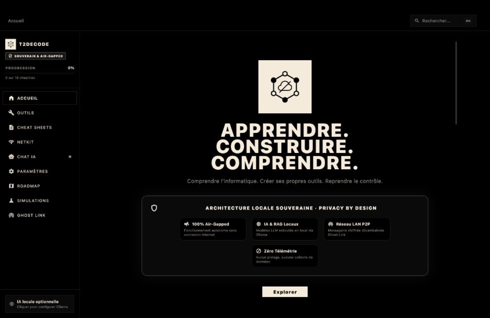

<meta name="fediverse:creator" content="@TUTODECODE@mastodon.social">

<div align="center">

<p><a href="README.md">Français</a> · <strong>English</strong></p>

<a href="https://tutodecode.org/en/"></a>

<h1>T2DECODE</h1>

<p>Free software to learn networking, Linux and cybersecurity.<br>
Works fully offline, with no account and no data collection.</p>

<p>
<a href="https://github.com/TUTODECODE-FR/T2DECODE/releases/latest"></a>
<a href="https://github.com/TUTODECODE-FR/T2DECODE/actions/workflows/ci.yml"></a>
<a href="LICENSE"></a>
<a href="https://f-droid.org/packages/org.t2decode.app/"></a>
<a href="https://snapcraft.io/t2decode"></a>
<a href="https://securityscorecards.dev/viewer/?uri=github.com/TUTODECODE-FR/T2DECODE"></a>
</p>

<p><a href="https://tutodecode.org/en/download/"><strong>Download</strong></a> · <a href="https://tutodecode.org/en/t2decode/">Overview</a> · <a href="https://tutodecode.org/en/schools/">Schools</a> · <a href="#contributing">Contributing</a></p>

</div>

<p align="center"></p>

## What T2DECODE does

T2DECODE brings together, in a single app, what you need to learn and practise technical IT, including in a computer lab with no Internet access.

| Module | Content |
| :--- | :--- |
| Courses | Networking, systems, Linux and security, with real-world cases and quizzes. |
| Simulations | Scan, ping, traceroute, attacks and defences, CTF preparation. Synthetic data: no real scan is ever run. |
| Linux terminal | A practice terminal to learn commands and bash without touching the system. |
| Tools | IPv4/IPv6 subnet calculator, chmod, cron, file checksums. |
| Cryptography | AES, RSA and hash functions, step by step. |
| Local assistant | Optional: if [Ollama](https://ollama.com) is installed on the computer, it answers from the courses. Nothing leaves the machine. |
| Your courses | Custom courses in the `.tdc` format, written with [TDC Studio](https://github.com/TUTODECODE-FR/tdc-sdk). |

No account, no telemetry, no advertising. The interface is in French.

## Install

All links, always up to date: **[tutodecode.org/en/download](https://tutodecode.org/en/download/)**

| System | Where | Notes |
| :--- | :--- | :--- |
| Windows 10/11 (64-bit) | [Installer](https://github.com/TUTODECODE-FR/T2DECODE/releases/latest/download/T2DECODE-Windows-Setup.exe) (15 MB) or [portable version](https://github.com/TUTODECODE-FR/T2DECODE/releases/latest/download/T2DECODE-Windows.zip) | Signed by TUTODECODE. "Install for me only" needs no administrator rights. If SmartScreen shows a warning: "More info", then "Run anyway". |
| macOS 10.15+ | [Mac App Store](https://apps.apple.com/app/id6762523276) or [disk image](https://github.com/TUTODECODE-FR/T2DECODE/releases/latest/download/T2DECODE-macOS.dmg) (24 MB) | Disk image notarized by Apple: drag T2DECODE to Applications. |
| Linux (64-bit) | `sudo snap install t2decode` or [.tar.gz archive](https://github.com/TUTODECODE-FR/T2DECODE/releases/latest/download/T2DECODE-Linux.tar.gz) (14 MB) | The Snap updates itself. Archive: see below. |
| Android 7.0+ | [Google Play](https://play.google.com/store/apps/details?id=org.tutodecode.t2decode), [F-Droid](https://f-droid.org/packages/org.t2decode.app/) or [APK](https://github.com/TUTODECODE-FR/T2DECODE/releases/latest) (25 MB) | F-Droid publishes each version a few days late. APK: see below. |

Homebrew:

```bash
brew tap tutodecode-org/tap https://gitlab.com/tutodecode-org/homebrew-tap.git
brew install --cask t2decode
```

For schools (silent install, offline computers, no administrator rights): see **[tutodecode.org/en/schools](https://tutodecode.org/en/schools/)**.

<details>
<summary><strong>Android APK and Obtainium</strong></summary>

- Recent phone: `app-arm64-v8a-release.apk`. Older 32-bit phone: `app-armeabi-v7a-release.apk`. Emulator or Intel Chromebook: `app-x86_64-release.apk`.
- Android asks you to allow installs from your browser or file manager ("unknown sources"): allow it for that app only.
- [Obtainium](https://github.com/ImranR98/Obtainium): add the URL `https://github.com/TUTODECODE-FR/T2DECODE` with the APK filter `arm64-v8a` (or your architecture).
- APKs are signed with the TUTODECODE key, SHA-256 fingerprint `fd1397a33761d54fbc988ae009f7f7dc0d215b487729268367b86a537664ea7e`. Versions up to 1.0.8.2 used a temporary key: if the update is refused, uninstall and reinstall once.
- Do not mix sources: a GitHub APK does not update the F-Droid version (different signatures), and Google Play is a separate app.

</details>

<details>
<summary><strong>Linux archive (without Snap)</strong></summary>

```bash
mkdir -p ~/T2DECODE && tar -xzf T2DECODE-Linux.tar.gz -C ~/T2DECODE
~/T2DECODE/T2DECODE
```

Requires GTK 3 and libsecret, already present on most desktops (Debian/Ubuntu: `sudo apt install libgtk-3-0 libsecret-1-0`).

</details>

## First test in 2 minutes

1. Open T2DECODE, then the **Boîte à outils** (toolbox) from the home screen.
2. Under **Simulateurs interactifs**, pick **Sous-réseaux IPv4** (IPv4 subnets).
3. Work out the network and broadcast addresses, then press "Vérifier" (check): the correction shows the binary calculation.

Next: **Terminal : missions** to practise Linux commands, or a course with its quiz.

## Verify the files

Every release is built publicly by GitHub Actions. Each [published release](https://github.com/TUTODECODE-FR/T2DECODE/releases/latest) includes `SHA256SUMS.txt` (checksums) and software bills of materials (CycloneDX and SPDX SBOMs).

```bash
shasum -a 256 T2DECODE-Linux.tar.gz              # macOS / Linux
Get-FileHash .\T2DECODE-Windows-Setup.exe        # Windows (PowerShell)
```

On Windows, the *Digital Signatures* tab of the file's properties must show **TUTODECODE**.

## Automated checks

On every change: unit and widget tests, `flutter analyze`, dependency scanning (OSV-Scanner) and CodeQL code analysis. On every release, in addition: code security analysis (Semgrep), secret scanning of the history (Gitleaks) and an antivirus scan of the built files (ClamAV). Results are visible in the [Actions](https://github.com/TUTODECODE-FR/T2DECODE/actions) tab.

## Build from source

Requirements: Flutter (version given in `.flutter-version`) and, depending on the system, the native build tools (Visual Studio 2022 with C++ on Windows, Xcode on macOS, `clang cmake ninja-build pkg-config libgtk-3-dev liblzma-dev` on Debian/Ubuntu).

```bash
git clone https://github.com/TUTODECODE-FR/T2DECODE.git
cd T2DECODE
make setup && make get && make test
flutter run
```

Build targets: `make build-windows`, `make build-macos`, `make build-dmg`, `make build-linux`, `make build-android`.

## Contributing

Bug reports, ideas and contributions are welcome.

- Bug or idea: [GitHub issues](https://github.com/TUTODECODE-FR/T2DECODE/issues)
- Security vulnerability: by email, never in a public issue. See [SECURITY.md](SECURITY.md).
- Code and courses: [CONTRIBUTING.md](CONTRIBUTING.md) (commits signed off with `Signed-off-by`), [VOLUNTEER_BOARD.md](VOLUNTEER_BOARD.md), [MAINTAINERS.md](MAINTAINERS.md)
- Technical documentation: [architecture](docs/architecture.md), [OWASP MASVS mapping](docs/masvs-mapping.md)

## Licence and publisher

T2DECODE is free software under the [GNU GPL v3](LICENSE).

Published by the TUTODECODE association (French non-profit, SIREN 102 763 133, RNA W134011896, Saint-Victoret), chaired by Maxime MARTIN CIVET. Website: [tutodecode.org](https://tutodecode.org/en/) · Contact: [tutodecode.org/en/contact](https://tutodecode.org/en/contact/) · Mastodon: [@TUTODECODE](https://mastodon.social/@TUTODECODE)

Main repository: GitHub. Mirrors: [GitLab](https://gitlab.com/tutodecode-org/T2DECODE), [SourceForge](https://sourceforge.net/projects/t2decode/).
